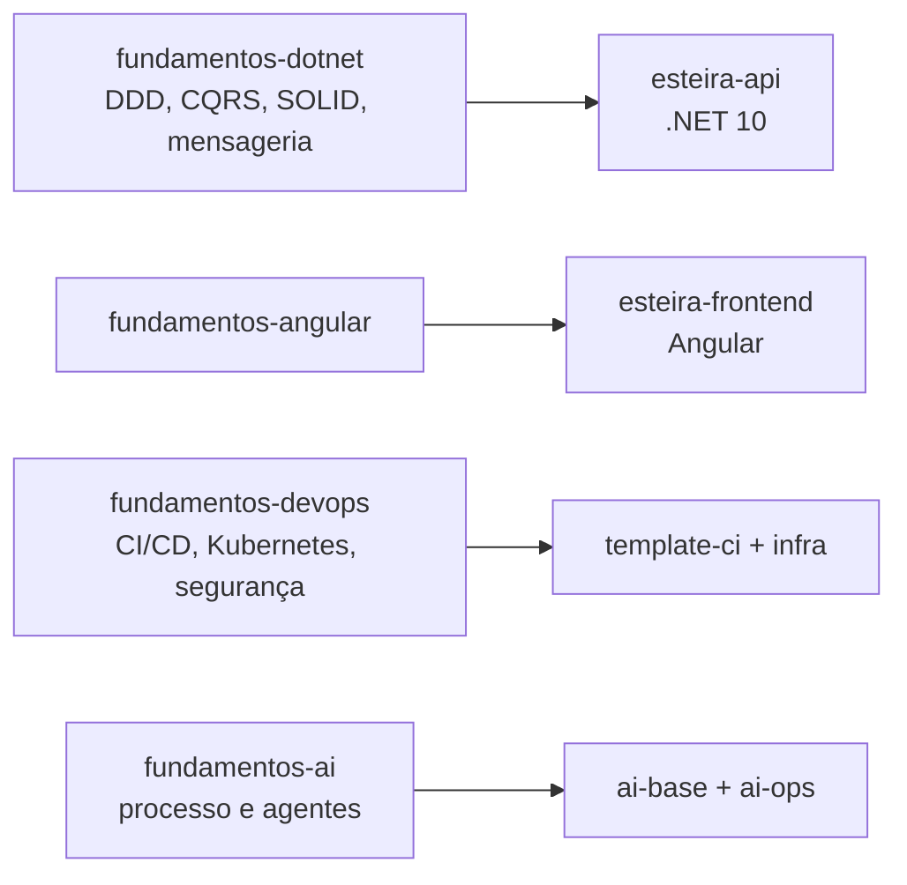

# fundamentos

Base de estudo de **.NET, Angular, DevOps e IA aplicada a engenharia**: conteúdo
em texto, com projetos de prática quando o assunto pede código. Todo conceito
estudado aqui é aplicado em um projeto real, a **Esteira**
([orchestration-ai](https://github.com/danielbmendprofissional/orchestration-ai)).

> **Este repositório é a vitrine.** Os fundamentos vivem em um **grupo do GitLab**
> (`fundamentos/...`). O GitHub não tem subgrupos, então aqui cada tema é um
> repositório agrupado pelo prefixo `fundamentos-` e pelo *topic*
> [`fundamentos`](https://github.com/search?q=topic%3Afundamentos%20user%3Adanielbmendprofissional&type=repositories).
> O histórico de commits é o original, completo.

## Estrutura original no GitLab × espelho no GitHub

```
GitLab (grupo)                 GitHub (plano)
fundamentos/                   danielbmendprofissional/
├── dotnet                     ├── fundamentos-dotnet
├── angular                    ├── fundamentos-angular
├── devops                     ├── fundamentos-devops
└── ai                         └── fundamentos-ai
```

## Do conceito à prática



## Os repositórios

| Repositório | Conteúdo | Aplicado em | GitLab |
|---|---|---|---|
| [`fundamentos-dotnet`](https://github.com/danielbmendprofissional/fundamentos-dotnet) | DDD, Clean Architecture/CQRS, Onion, SOLID, Design Patterns, paralelismo, RabbitMQ, trilha de auditoria | `esteira-api` | `fundamentos/dotnet` |
| [`fundamentos-angular`](https://github.com/danielbmendprofissional/fundamentos-angular) | Angular | `esteira-frontend` | `fundamentos/angular` |
| [`fundamentos-devops`](https://github.com/danielbmendprofissional/fundamentos-devops) | CI/CD, containers, Kubernetes, segurança no pipeline | `template-ci`, `infra` | `fundamentos/devops` |
| [`fundamentos-ai`](https://github.com/danielbmendprofissional/fundamentos-ai) | IA aplicada à engenharia | `ai-base`, `ai-ops` | `fundamentos/ai` |

## Como cada repositório é organizado

- `Conteudo/`: material em texto, por assunto.
- Projetos de prática (`src`) quando o tema pede código.
- Histórico preservado dos estudos originais.
